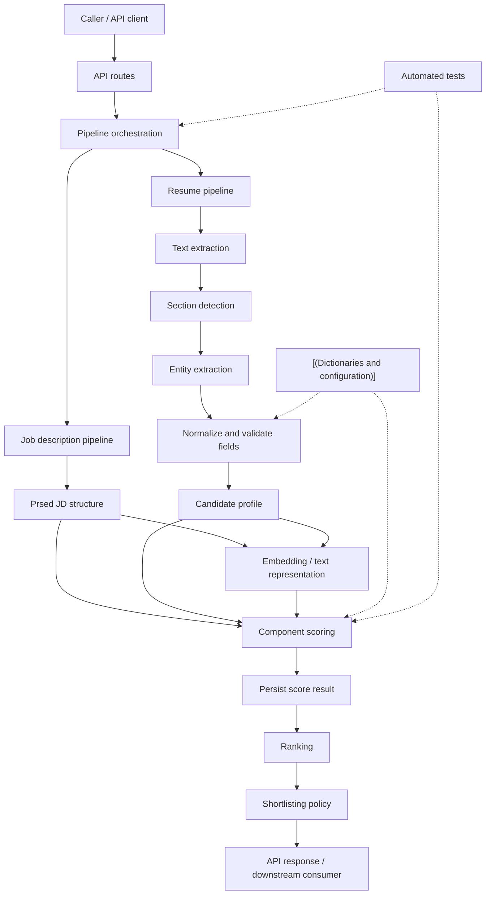
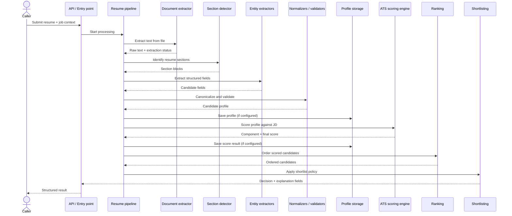
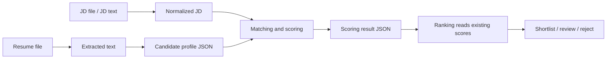

# ZechPath ATS — Architecture and Diagrams

## 1. Architecture overview

The repository is organized as a modular Python codebase. The following diagrams describe the **logical ATS flow** and are intended to be checked against the active runtime call graph before deployment.

## 2. High-level component diagram

## 3. Resume processing sequence

## 4. Data flow and persistence boundaries

Persistence in this project has historically used file-based JSON outputs under `data/` subdirectories. Confirm the exact current paths in the active configuration and save functions. The diagrams intentionally do not imply a database or external queue unless configured by the implementation.

## 5. Repository module map

The public repository tree includes these top-level areas:

| Path | Architectural role |
|---|---|
| `api/` | API surface |
| `document_processing/` | Document and resume/JD processing |
| `parsers/` | Parsing logic and helpers |
| `pipelines/` | End-to-end orchestration |
| `schemas/` | Structured models/contracts |
| `embeddings/` | Embedding generation |
| `matching/` | Candidate/JD matching |
| `similarity/` | Similarity utilities |
| `scoring/` | ATS scoring |
| `jobs/`, `workers/` | Job/background execution modules; confirm runtime usage |
| `data/` | Data files, dictionaries, fixtures, or outputs |
| `tests/` | Regression and unit tests |
| `utils/` | Shared helpers |
| `main.py` | Root entry point / local runner |

## 6. Design boundaries to preserve

1. **Extraction vs scoring:** extract and normalize facts first; scoring should consume structured data rather than re-parse raw text independently.
2. **Scoring vs ranking:** scoring computes scores; ranking orders persisted score records. Ranking should not recalculate ATS scores.
3. **Policy vs mechanics:** shortlist thresholds belong in a clearly defined policy/configuration layer.
4. **Dictionaries vs code:** canonical skill aliases, institution aliases, job titles, company suffixes, and location dictionaries should be data-driven where possible.
5. **External model vs deterministic logic:** if an LLM is added for ambiguous section detection, treat its output as a suggestion that is schema-validated and reconciled with deterministic rules. Do not make it a mandatory dependency for every clear heading.
6. **Sensitive data:** resume content and personal information should not be written to ordinary application logs.

